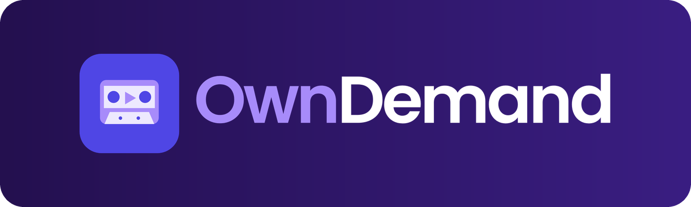
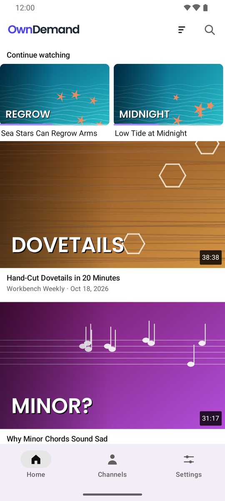
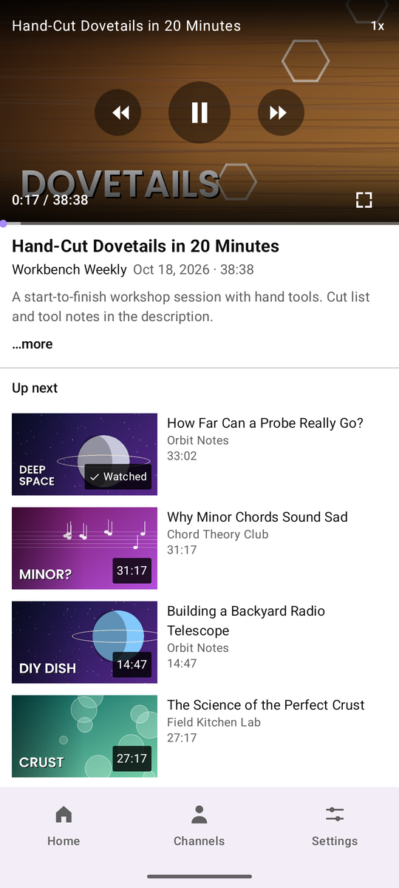
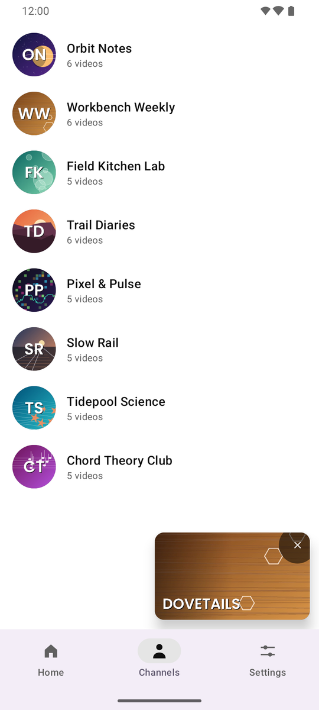
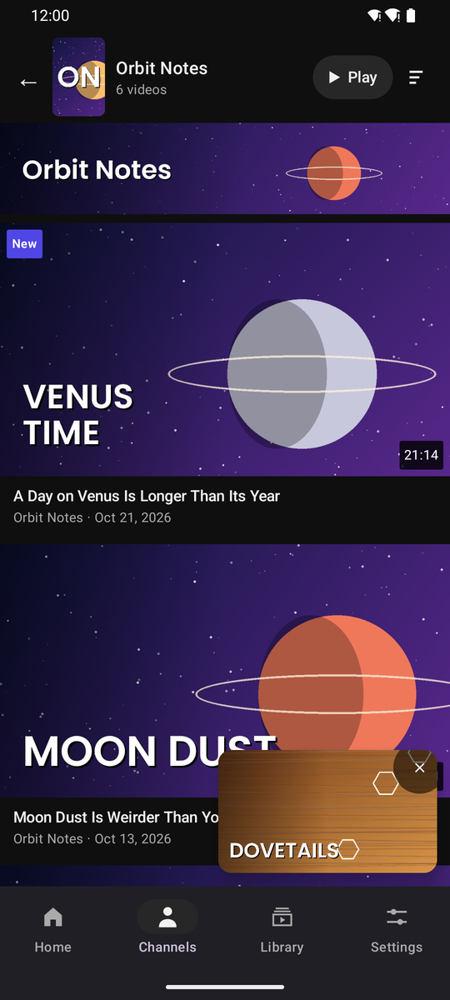
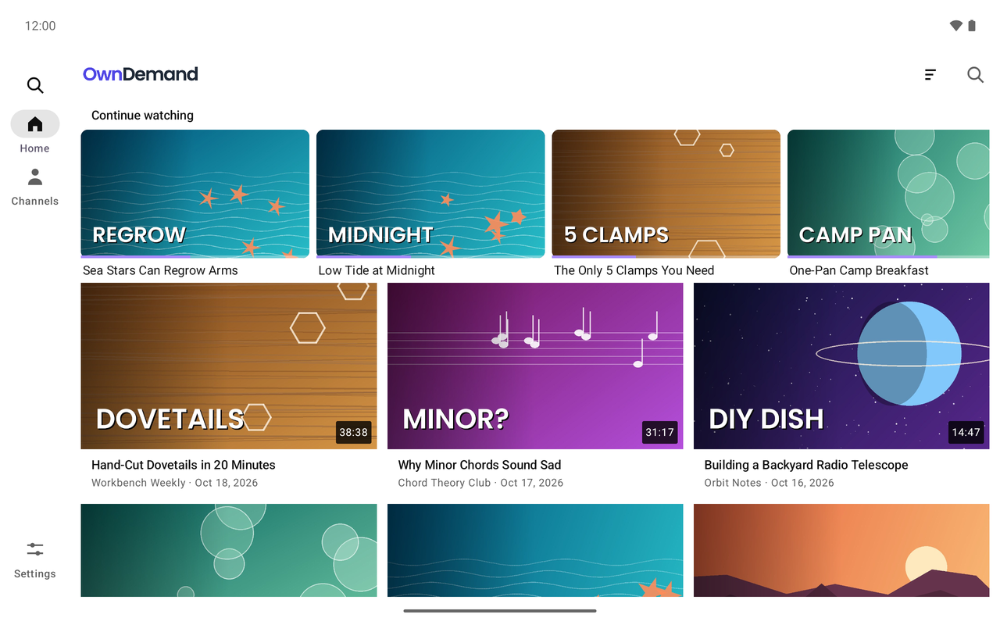
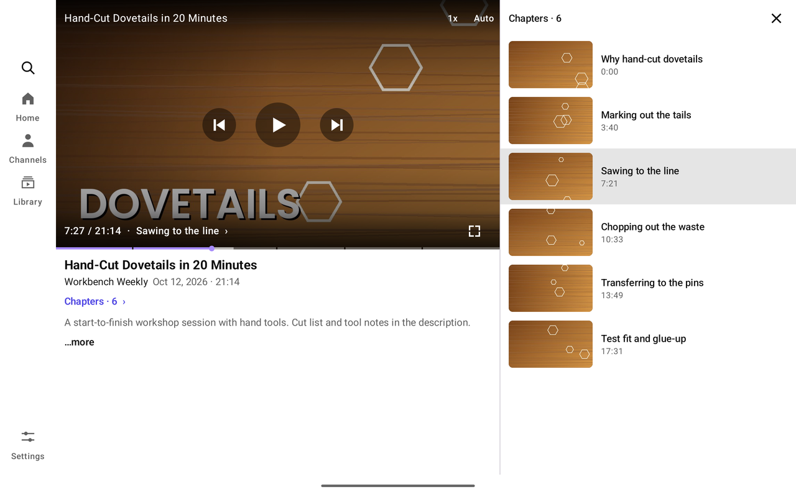
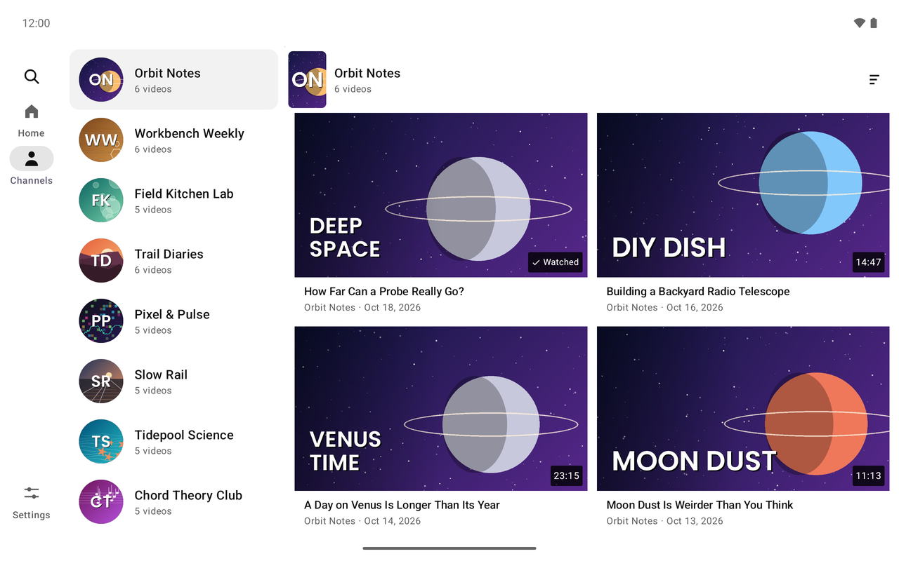
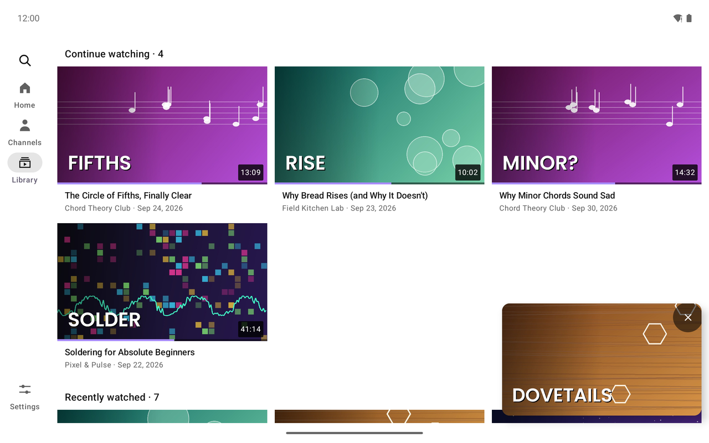

<p align="center">
  
</p>

<p align="center">
  <strong>Your channel videos, your Plex server — with a proper video-app feel.</strong>
</p>

<p align="center">
  
  
  
  
  
  <a href="LICENSE"></a>
</p>

OwnDemand is an Android app for browsing and watching the channel videos
already in your [Plex Media Server](https://www.plex.tv/) library — a
familiar feed / channels / watch experience instead of Plex's folder
hierarchy. Tap a video and it plays immediately; keep browsing while it
plays in a floating miniplayer.

It talks only to *your own* server with *your own* Plex sign-in. No
accounts, no backend, no analytics, no third-party services.

## Screenshots

<p align="center">
  
  
  
  
</p>

<p align="center">
  
  
  
  
</p>

<p align="center"><sub>Screenshots use a fictional demo library — every channel, video and thumbnail is made up.</sub></p>

## Features

- **Home** — fresh additions mixed with things you haven't watched yet,
  plus a *Continue watching* row that resumes where you left off.
- **Channels** — your Plex Collections presented as channels, with channel
  artwork; a two-pane channel browser on tablets.
- **Playback-first watch screen** — tap any card and playback starts
  immediately. Expandable description, *Up next*, fullscreen, captions,
  scrub previews, double-tap seek, pinch-to-zoom.
- **Miniplayer** — drag the video down (or switch tabs) and it keeps
  playing in a floating, draggable miniplayer while you browse.
- **Picture-in-picture and background audio** — leave the app and the
  video keeps going in a small floating window, or as sound with
  previous / play-pause / next on the notification, lock screen and
  headset. Both can be switched off in Settings.
- **Search** across the selected library — titles and channel names.
- **Resume & watched state** synced back to Plex, so other Plex clients
  stay in step.
- **Direct play** when the device can decode the file, Plex's own
  transcoder when it can't, and a data-saver mode.
- **Adaptive layouts** for phones, tablet portrait, and tablet landscape
  (side navigation, multi-column grids, two-pane watch screen); light and
  dark themes.

## How it fits together

OwnDemand reads a Plex library where **each channel is a Plex
Collection** — exactly what [Youtarr](https://github.com/DialmasterOrg/Youtarr)
produces, though any library organised that way works. Plex stays the
source of truth; OwnDemand never downloads, moves or edits media.

## Requirements

- Android 8.0 (API 26) or newer.
- A Plex Media Server you own, with **Settings → Network → Secure
  connections** set to *Preferred* (Plex's default) or *Required*.
  OwnDemand connects over HTTPS only.
- A Plex library of videos organised into Collections (one per channel).

## Install

1. Download `OwnDemand-<version>.apk` from the
   [latest release](https://github.com/viper33802/OwnDemand/releases/latest).
2. Open it on your Android device. The first time, Android asks you to allow
   *Install unknown apps* for your browser or file manager — allow it, then
   tap **Install**.
3. Open OwnDemand, sign in with Plex (it opens plex.tv in your browser to
   approve a short code), pick your server, then pick the video library.

Updates install over the previous version as long as they come from these
releases (they are all signed with the same key). Each release lists the
APK's SHA-256 checksum if you want to verify the download.

## Build from source

Requires JDK 21 and the Android SDK.

```bash
./gradlew assembleDebug          # APK: app/build/outputs/apk/debug/app-debug.apk
adb install -r app/build/outputs/apk/debug/app-debug.apk
./gradlew testDebugUnitTest      # JVM unit tests
```

A debug build is signed with your local debug key, so it cannot update an
installed release build (uninstall one before installing the other).
`./gradlew assembleRelease` produces an unsigned release APK unless you
configure your own signing key — see [`docs/RELEASING.md`](docs/RELEASING.md).

## Security & privacy

- **HTTPS only.** Cleartext traffic is disabled for the whole app; servers
  are reached through their `*.plex.direct` HTTPS addresses, and only
  system certificate authorities are trusted.
- **Tokens stay on the device**, encrypted with an Android Keystore
  AES-GCM key, excluded from cloud backup and device transfer, and never
  logged or displayed.
- **No third parties.** The app talks to plex.tv (sign-in and server
  discovery) and to your server — nothing else.
- Signing out removes the stored tokens.

## Optional: channel artwork for Youtarr libraries

If you use [Youtarr](https://github.com/DialmasterOrg/Youtarr) to keep a
channel-video library in Plex, it saves `poster.jpg` (channel art) and
`backdrop.jpg` (channel banner) in each channel folder. Plex ignores those
channel-level files — its local agent only reads assets inside the per-video
folders — so every collection gets an auto-generated poster collage instead
of the channel artwork.

`tools/plex-collection-art.sh` fixes that the same way the Plex Web UI does:
it uploads each channel's `poster.jpg` as the collection **poster** and
`backdrop.jpg` as its **background** through the Plex API. OwnDemand then
shows the real channel art, as do Plex's own clients.

Run it **on the machine that hosts the library** (the paths must be local),
with any Plex token that has library-edit permission — typically your own.

```bash
cp tools/plex-collection-art.sh /usr/local/bin/
chmod +x /usr/local/bin/plex-collection-art.sh

# store your token (read automatically), or export PLEX_TOKEN=... first.
# read -s keeps it out of your shell history and off the screen.
(umask 077 && read -rs -p 'Plex token: ' t && printf '%s\n' "$t" > ~/.owndemand-scan-token)

# point LIB_DIR at the library root (server-side path)
LIB_DIR=/srv/media/videos plex-collection-art.sh --dry-run   # show matches, change nothing
LIB_DIR=/srv/media/videos plex-collection-art.sh             # upload; collections with uploaded art are skipped
LIB_DIR=/srv/media/videos plex-collection-art.sh --force     # re-upload everything
```

Configuration via environment variables:

| Variable     | Default                  | Meaning                          |
|--------------|--------------------------|----------------------------------|
| `PLEX_URL`   | `http://127.0.0.1:32400` | Plex server address (loopback on the server itself, so the token never crosses the network) |
| `LIB_DIR`    | *(required)*             | Library root, server-side path   |
| `SECTION`    | auto-detected            | Plex library id                  |
| `PLEX_TOKEN` | from token file          | API token                        |

Matching is case- and quote-insensitive (Plex XML-escapes apostrophes; the
script normalises both sides, so channels like `Some Creator’s Workshop`
match). Unmatched folders are listed at the end so you can fix naming.

### Auto-start on Ubuntu (systemd timer)

Run it daily — and once soon after every boot, catching anything Youtarr
synced while the server was down:

```bash
# /etc/systemd/system/plex-collection-art.service
[Unit]
Description=Push Youtarr channel artwork into Plex collections
Wants=network-online.target
After=network-online.target

[Service]
Type=oneshot
User=youruser
Environment=LIB_DIR=/srv/media/videos
ExecStart=/usr/local/bin/plex-collection-art.sh

# /etc/systemd/system/plex-collection-art.timer
[Unit]
Description=Daily Plex collection artwork sync

[Timer]
OnCalendar=*-*-* 04:30:00
OnBootSec=20min
Persistent=true

[Install]
WantedBy=timers.target
```

```bash
sudo systemctl daemon-reload
sudo systemctl enable --now plex-collection-art.timer
systemctl start  plex-collection-art.service    # manual run now
journalctl -u  plex-collection-art.service -n 50  # see its output
```

The token lives only in `~youruser/.owndemand-scan-token` (mode `600`).
Uploaded artwork replaces the auto-collage and stays until you re-pick the
collage in the Plex Web UI (collection → Edit → Posters).

## Licence

OwnDemand is licensed under the [Apache License, Version 2.0](LICENSE).
See [`NOTICE`](NOTICE) for the copyright notice and the third-party
libraries the app includes; the app shows both under
*Settings → Open-source licences*.

The OwnDemand name and logo are not covered by the licence. OwnDemand is an
independent project, not affiliated with or endorsed by Plex, Inc. Plex is a
trademark of Plex, Inc.

## Contributing

See [`AGENTS.md`](AGENTS.md) for project guidelines and [`docs/`](docs/) for
design and verification notes. Bug reports and pull requests are welcome.
